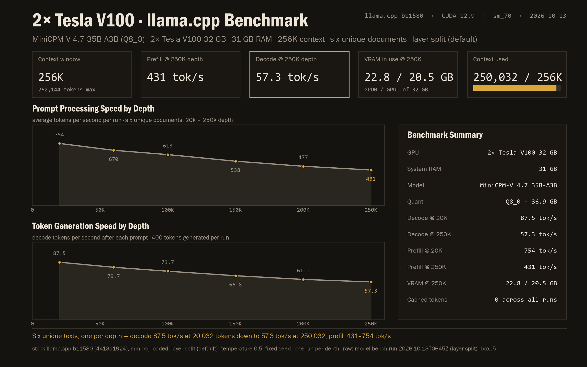
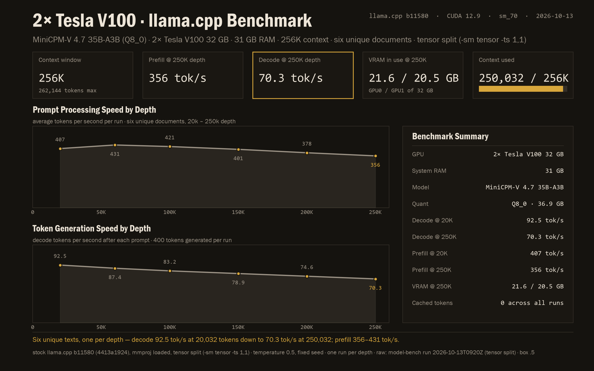
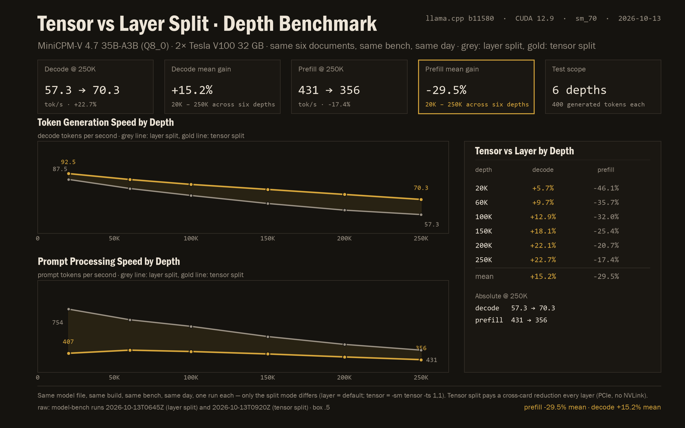

# MiniCPM-V 4.7 35B-A3B (Q8_0) on 2× Tesla V100 — llama.cpp bench, layer vs tensor split

**12 measured runs, 0 failed, 2026-10-13.** Two six-depth benches of the new MiniCPM-V 4.7
MoE (35B total, 3B active — Qwen3.6 backbone + SigLIP2 vision), the first MoE in the MiniCPM-V
line, at Q8_0 on 2× Tesla V100 32 GB, served by llama.cpp **build b11580** (`4413a1924`, the
first master build with MiniCPM-V 4.7 support): once with the default **layer split**, once with
**tensor split** (`-sm tensor -ts 1,1`).

The findings:

- **Layer split (default): decode 87.5 → 57.3 tok/s (20K → 250K); prefill 754 → 431 tok/s.**
- **Tensor split: decode 92.5 → 70.3 tok/s; prefill 407 → 356 tok/s.** Decode is faster at every
  depth and the gap grows with context — **+5.7% at 20K to +22.7% at 250K, +15.2% mean**. Prefill
  pays for it — **−46.1% at 20K shrinking to −17.4% at 250K, −29.5% mean**. Tensor split sends one
  reduction per layer across the PCIe bus (no NVLink on this box): at shallow depths that dominates,
  at depth the prefill work is large enough to amortise it.
- **The full 256K window fits both ways**: a 250,032-token prompt served clean, 22.8 + 20.5 GB
  (layer) / 21.6 + 20.5 GB (tensor) VRAM in use of 32 GB per card. The Q8_0 file is 36.9 GB — all
  256 experts resident in combined VRAM, zero expert streaming at run time.
- **Vision works on the V100s**: the f16 mmproj read a test image's text and shapes correctly in
  5.2 s wall (one request, layer-split session).
- **Classic `-sm row` is gone from CUDA**: upstream removed it (`74976e1ae "CUDA: remove -sm row,
  refactor cuBLAS"`); on this build it aborts at load with `device CUDA0 does not support split
  buffers`. The `-sm tensor` mode (experimental tensor parallelism, weights + KV) is the working
  tensor-split implementation — checked in `src/llama-arch.cpp` that `qwen35moe` is allowed.
- **No MTP arm**: the official GGUF ships no MTP/nextn tensors, and the source checkpoint's weight
  index has zero MTP keys — there is no in-model drafter for this model (the DSpark drafter is a
  separate release, out of scope).

Each split mode has its own card; the third chart compares them:







**The numbers:**

| depth | prompt tok | layer: prefill / decode | tensor: prefill / decode |
|---|---:|---:|---:|
| 20K | 20,032 | 754.0 / 87.5 | 406.7 / 92.5 |
| 60K | 60,032 | 670.5 / 79.7 | 431.4 / 87.4 |
| 100K | 100,032 | 618.4 / 73.7 | 420.7 / 83.2 |
| 150K | 150,032 | 538.2 / 66.8 | 401.4 / 78.9 |
| 200K | 200,032 | 476.6 / 61.1 | 378.0 / 74.6 |
| 250K | 250,032 | 431.4 / 57.3 | 356.5 / 70.3 |

Mean deltas (tensor vs layer): **decode +15.2% · prefill −29.5%**.

**Method:** one run per depth per split mode, six unique documents (one per depth), 400 generated
tokens each, temperature 0.5, fixed seed, unique tag per request; prefill/decode read from
llama.cpp's own `timings`; identical sliced prompts on both sides (the data builder asserts the
prompt-token counts match at every depth). Raw records: runs `2026-10-13T0645Z` (layer) and
`2026-10-13T0920Z` (tensor) — see [`PROVENANCE.md`](PROVENANCE.md).

**What's in the folder:**

```
data/raw/     both runs' raw per-arm records + metas (sha256-checked copies), the engine's own
              per-request log extracts for each run, the vision smoke-test response, and the
              exact serving command per split mode
data/csv/     the per-mode depth tables and the combined comparison table (everything the charts read)
charts/       the three charts above, and the scripts that draw them (read-only from the CSVs)
experiments/  the setup notes and what the numbers say, per stage
scripts/      the data builder (asserts comparability) and the three chart scripts
```

**Honest limits:** one run per depth per mode — single cells at depth carry the usual ±5-8%
run-to-run noise class, so read the means and the shapes, not the third significant figure of any
single point; tensor mode is upstream-experimental; no serving-flag sweeps beyond the split-mode
pair; one quant (Q8_0); no MTP/DSpark arms (nothing to test — see above).
