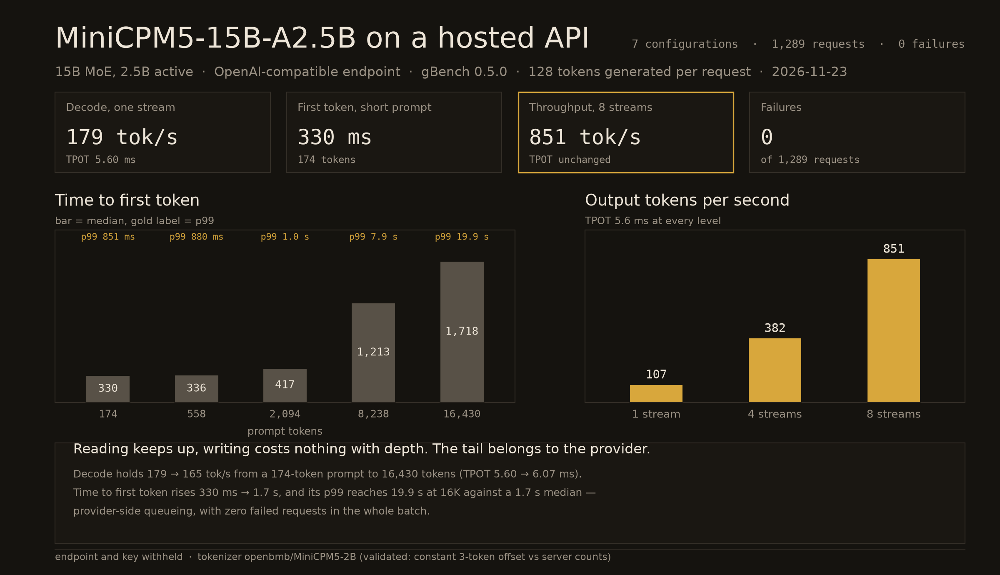

# MiniCPM5-15B-A2.5B on a hosted API — gbench serving benchmark

**7 measured configurations, 1,289 requests, 0 failures, 2026-11-23.** The 15B MoE MiniCPM5
(2.5B active) served by a hosted OpenAI-compatible endpoint, measured with DeepMind **gBench
0.5.0.post1** in remote-endpoint mode from the Hermes host. The endpoint URL and the API key are
deliberately absent from this repo.

The model reports a 512K-token context window and function calling. Nothing here tests capability —
this is the serving pillar only: latency and throughput.

## The numbers

Single stream (batch 1), 128 tokens generated per request:

| prompt tokens (requested → delivered) | TTFT p50 | TTFT p99 | TPOT p50 | ITL p50 | output tok/s | requests |
|---:|---:|---:|---:|---:|---:|---:|
| 128 → 174 | 330 ms | 851 ms | 5.60 ms | 5.66 ms | 107.2 | 140 |
| 512 → 558 | 336 ms | 880 ms | 5.61 ms | 5.67 ms | 102.5 | 140 |
| 2,048 → 2,094 | 417 ms | 1,005 ms | 5.63 ms | 5.72 ms | 89.3 | 140 |
| 8,192 → 8,238 | 1,213 ms | 7,885 ms | 5.82 ms | 5.51 ms | 53.8 | 70 |
| 16,384 → 16,430 | 1,718 ms | 19,886 ms | 6.07 ms | 3.62 ms | 35.9 | 70 |

Concurrency at a 512-token prompt, 128 tokens out:

| streams | TTFT p50 | TTFT p99 | TPOT p50 | output tok/s | requests |
|---:|---:|---:|---:|---:|---:|
| 4 | 359 ms | 996 ms | 5.62 ms | 382.1 | 281 |
| 8 | 346 ms | 898 ms | 5.61 ms | 850.8 | 500 |

## The findings

- **Decode is flat with depth.** TPOT moves from 5.60 ms at a 174-token prompt to 6.07 ms at
  16,430 tokens — 179 → 165 tokens per second, an 8% cost for a 94× longer prompt. Per-stream
  decode is essentially the model's constant.
- **Prompt reading is cheap until it isn't.** TTFT goes 330 ms → 1,718 ms across the same range:
  about 9.6K prompt tokens per second marginal, but the medians hide a long tail.
- **The tail is the story at depth.** TTFT p99 is 19.9 s at 16K and 7.9 s at 8K while the medians
  are 1.7 s and 1.2 s. TPOT p99 rises to 16–24 ms. Nothing failed, so this is queueing or
  rate-shaping on the provider side, not model error.
- **Throughput scales almost linearly to 8 streams**: 107 → 382 → 851 output tok/s at 1, 4 and 8
  concurrent requests, with TPOT unchanged at 5.6 ms. Capacity here is concurrency, not per-stream speed.
- **No failures, no ignored limits.** 1,289 requests completed, 0 errors; the endpoint honoured
  `ignore_eos` (128 tokens generated every time) and template overhead is a constant 46 tokens.
- **Not tested:** prompts beyond 16,384 tokens (the 512K window), the open-loop stress/SLO sweep,
  and every capability pillar.

## Method

- Harness: gBench 0.5.0.post1, `--remote-endpoint` against the provider's `/v1`, model id
  `MiniCPM5-15B-A2.5B`, `--max-model-len 32768 --max-output-tokens 256`, temperature 0.0,
  `--output-lengths 128`, one iteration per configuration, `--no-stress-test`.
- Prompt sizing: tokenizer `openbmb/MiniCPM5-2B`, the closest published tokenizer to this model.
  Validated against the endpoint before the runs: rendered prompt counts differ by a constant
  3 tokens from the server's `usage.prompt_tokens` at both short and 1.2K-token prompts, i.e. the
  same tokenisation with a slightly different template, not a different vocabulary. Every row
  above carries the server's own delivered count for that reason.
- Payloads are unique per request (gBench salts them), so the provider's prompt cache
  (`cached_tokens` up to 18,011 in a manual probe) contributes nothing to these figures.
- Two runs were discarded, not reported: an initial 8,192-token and an initial 16,384-token
  attempt hit my own 300-second client timeout while the provider was still serving them. Re-run
  with a 900-second budget they completed with zero failures. The discarded attempts produced no
  measurement at all.

## What is in the folder

`summary.csv` has every figure above in machine-readable form; `results/` holds the raw gBench
result JSON for each configuration (TTFT/TPOT/ITL distributions, throughput, request counts and
the scaffold-contract ids). gBench records the endpoint URL in each result file, so that one field
is replaced with `redacted-hosted-endpoint`; everything else is untouched.
