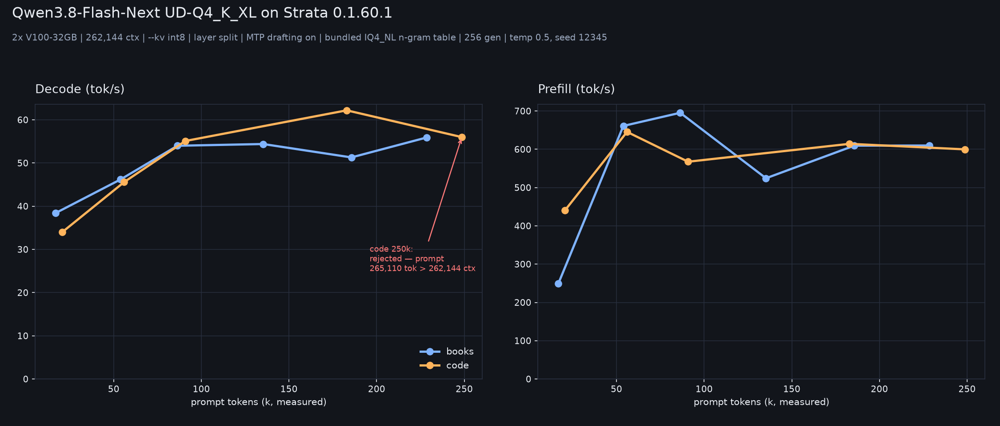

# Qwen3.8-Flash-Next UD-Q4_K_XL — Strata

First speed run of the Unsloth UD-Q4_K_XL file of Qwen3.8-Flash-Next under Strata, at the full
262,144-token context with an 8-bit KV cache, on the two V100s.

Measured 2026-11-16 on box .5 (`eamon-ai`, 192.168.1.5). One run per depth per corpus.

## Stack

| | |
|---|---|
| Engine | Strata v0.2.14.1, engine 0.1.60.1, local sm_70 build (CUDA 12.9) |
| Model file | `Qwen3.8-Flash-Next-UD-Q4_K_XL-00001…00003-of-00004.gguf` (82.53 GB) |
| N-gram table | bundled `-00004-of-00004.gguf`, IQ4_NL, 28.80 GB |
| Drafting | MTP (`--mtp`, `--spec 4`, `--spec-min-p 0.5`) |
| Context | `--max-context 262144`, `--kv int8` |
| GPU split | 2× Tesla V100-32GB, `--layer-split auto` → layers 0–23 CUDA0, 24–47 CUDA1 |
| Memory | `--resident-budget-gib 8`, experts via mmap; pinned cache 8 GiB |
| Harness | `~/model-bench/bench.py`, `--gen 256`, temp 0.5, seed 12345, `cache_prompt: false` |
| Load time | 110 s to `/v1/models` answering ready |

Config on the box: `/home/eamon/Strata/strata-unsloth-ud-q4_k_xl.json`.
Run folders: `~/model-bench/runs/2026-11-16T0210Z-flashnext-q4kxl-iq4nl-books`,
`~/model-bench/runs/2026-11-16T0231Z-flashnext-q4kxl-iq4nl-code`.

## Results

Depths are nominal (20k…250k); the measured prompt token count is given because the two corpora
tokenise differently and it is the real x-axis.

**Books**

| depth | prompt tokens | prefill tok/s | decode tok/s | draft acceptance |
|---:|---:|---:|---:|---:|
| 20K | 16,793 | 248.9 | 38.4 | 75 % |
| 60K | 53,924 | 661.1 | 46.2 | 66 % |
| 100K | 86,341 | 695.4 | 54.0 | 68 % |
| 150K | 135,285 | 524.4 | 54.4 | 72 % |
| 200K | 185,612 | 609.5 | 51.3 | 63 % |
| 250K | 228,436 | 609.9 | 55.9 | 65 % |

**Code**

| depth | prompt tokens | prefill tok/s | decode tok/s | draft acceptance |
|---:|---:|---:|---:|---:|
| 20K | 20,645 | 440.8 | 34.0 | 83 % |
| 60K | 56,005 | 645.5 | 45.6 | 67 % |
| 100K | 90,823 | 567.6 | 55.1 | 67 % |
| 150K | 182,935 | 614.3 | 62.2 | 70 % |
| 200K | 248,622 | 599.9 | 56.0 | 72 % |
| 250K | 265,110 | — | — | rejected: `request exceeds the context window` |



## What the numbers say

- Decode **38.4 → 55.9 tok/s** on books and **34.0 → 62.2 tok/s** on code across the ladder: it
  holds up at depth rather than decaying. The 20K arm is the slowest per token, not the fastest —
  it carries first-touch expert reads from the SSD, which the deeper arms amortise.
- Prefill is **441–695 tok/s**, with the 20K arm depressed for the same reason.
- Draft acceptance 63–83 %, holding to 250K.
- The code 250K arm is a **failure, not a slow run**: 265,110 tokens against a 262,144 window gave
  `HTTP 400 … request exceeds the context window`. The books ladder fits the same nominal depth
  because prose tokenises less densely.

## The BF16 n-gram table works — after a 192-byte header stamp

The request was to serve this file with Unsloth's standalone BF16 engram table (102.4 GB) in place
of the bundled IQ4_NL shard. Out of the box the engine refuses it, and the first three attempts
here did too:

1. `--ple-gguf <BF16 file>` with the bundled shard still in place →
   `native dense: additional shard must match the architecture-validated first shard's split metadata`
2. `--ple-gguf <BF16 file>` with the bundled shard moved out →
   `--native …: missing model shard …-00004-of-00004.gguf (shard 4 of 4; is the download complete?)`
3. BF16 file put in the shard-4 filename →
   `…-00004-of-00004.gguf does not declare itself shard 4 of 4 of this model (split.count / split.no / split.tensors.count)`

The cause is in Strata's own source, and it is documented in **Strata issue #6013**: the engine
treats a `--ple-gguf` file as a table-only file only when its header carries
`general.architecture = "strata-ple"`. Unsloth's `engram/*.gguf_file` files have **no
`general.architecture` key at all**, so they are routed into the dense-shard loader, which is
right to reject them. `split.tensors.count` already matches (1224); the split keys are a red
herring, which is why re-stamping them alone (Unsloth's `set_split.py`) still fails.

The fix is a header-only rewrite: add `general.architecture = "strata-ple"`, drop the `split.*`
keys, pad so `data_start` keeps its exact offset, and the 102.4 GB of tensor data is never
touched. The script is in #6013 verbatim; it reported `n_kv 3->2, tensor-info end 173->192,
data_start stays 192`, and the engine then started with:

```
strata generate: PLE direct read probe: 77201 rows/s (fine)
strata generate: PLE on, table 320001536 rows of …/engram/Qwen3.8-Flash-Next-engram-BF16.gguf_file
```

Feature request for doing this natively is **Strata #5248** (open); the engine kernels already
read BF16/Q8_0/Q5_1/IQ4_NL, so only the installer/pinning layer is missing.

### What the lossless table costs

Same file, same config, only `--ple-gguf` differs. Two depths per corpus.

| corpus | depth | IQ4_NL prefill | BF16 prefill | IQ4_NL decode | BF16 decode |
|---|---:|---:|---:|---:|---:|
| books | 20K | 248.9 | 292.4 | 38.4 | 32.9 |
| books | 100K | 695.4 | 448.9 | 54.0 | 54.2 |
| code | 20K | 440.8 | 505.3 | 34.0 | 27.7 |
| code | 100K | 567.6 | 436.3 | 55.1 | 45.2 |

Decode is roughly a wash on prose (54.2 vs 54.0 at 100K) and −18 % on code (45.2 vs 55.1).
Prefill pays consistently: **−23 % to −35 %**, because prefill streams the table hard and BF16's
rows are 320 bytes against IQ4_NL's 90.

## Flags, not the file: what did *not* explain the gap to the older numbers

The earlier GSQ-RCO IQ3_S run on this box (2,148.8 tok/s prefill, 69.1 decode at 100K) used a
different flag set. Re-running **this** file with those flags (`--mmap-experts
--vram-reserve-mib 700 --remote-expert-opt`, no `--resident-budget-gib`) gave
**538.3 / 38.2** at 100K — worse than the shipped config's 695.4 / 54.0. The gap is the file size
(82.53 GB of weights against IQ3_S's 54.8) and 32 GB of RAM against 111 GB of files: the engine
log for a 100K request shows 493 GB read from storage, page cache holding 54 %, and a 0 MB/window
read-ahead budget.

Method note: the Strata option for an 8-bit cache is `--kv int8`; there is no `q8_0` choice.

