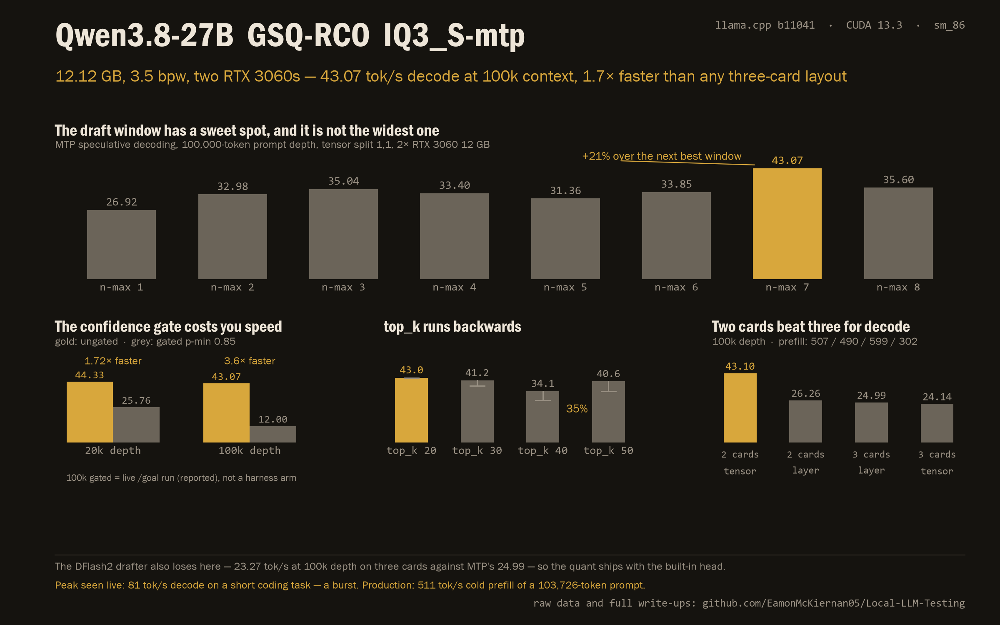
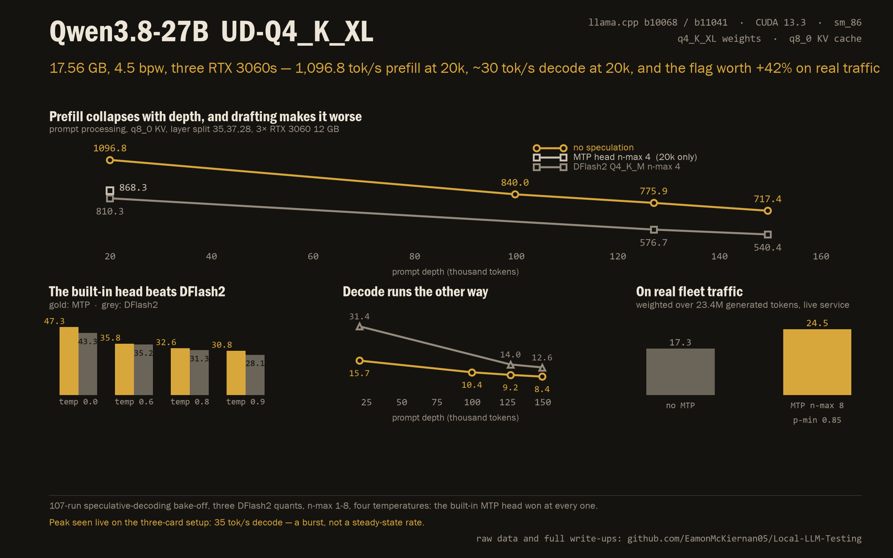

# Local-LLM-Testing
All configurations and tests done on my local ai server

## Current Hardware Setup

CPU: Xeon E5 2680 V4

RAM: 32GB DDR4 2400mhz 

GPUs: 2x Tesla V100 32GB

NVME: 256gb PCIe 3.0 x4 NVME SSD

Motherboard: MACHINIST X99-MR9A PRO MAX — single socket, no NVLink; 2x PCIe 3.0 x16 + 1x PCIe 2.0 x4 (Electrically x16)

## Planned Upgrades:

+32GB DDR4 2400mhz - already purchased

Dual Xeon Motherboard - on order

2x Xeon E5 2650 V4 - stored from previous builds/projects

512gb PCIe 3.0 x4 NVME SSD - on order

---

## Tests

Latest measured numbers, one row per model file. Every figure is a real run on box .5 — the dataset section below each row carries the method, the battery and the caveats.

| model (quant) | engine | measured | context | best prefill | decode | runs |
|---|---|---|---:|---|---|---:|
| DeepSeek-V4.1-Flash-1017 (Maya-XS IQ1_S) | Project Maya v1.1.22 | 2026-10-22 | 131K | **383.7 tok/s** (100K) | 14.1–17.3 tok/s | 2 |
| DeepSeek-V4.1-Flash-1017 (Maya-S IQ2_XXS) | Project Maya v1.1.19 | 2026-10-21 | 131K | **155.3 tok/s** (100K) | 5.5–7.3 tok/s | 2 |
| GLM-5.3-Flash (AJ-IQ2_XXS) | Project Maya v1.1.15 | 2026-10-17 | 256K | **870 tok/s** (200K) | 22.5–24.9 tok/s | 87 |
| GLM-5.3-Flash (Maya-S v2 IQ2_XXS) | Project Maya v1.1.11 | 2026-10-15 | 64K | **451 tok/s** (60K) | 18.7 tok/s (60K) | 66 |
| Qwen3.8-Flash-Next (GSQ-RCO IQ3_S) | Strata 0.2.0-beta | 2026-10-19 | 256K | **2,149 tok/s** (100K) | 73.7 → 64.2 tok/s | 305 |
| Qwen3.8-27B (IQ3_S + MTP, UD-Q4_K_XL) | llama.cpp | 2026-09-23 | 150K | **1,097 tok/s** (20K) | 43.1 tok/s (100K) | 284 |
| MiniCPM-V 4.7 35B-A3B (Q8_0) | llama.cpp b11580 | 2026-10-13 | 256K | **754 tok/s** (20K) | 87.5 → 57.3 tok/s (layer split) | 12 |

Prefill is the best measured value and the depth it was measured at; decode is the per-depth range across the dataset's own depths. Where a dataset compares engine versions, the row carries the newest engine and the section quotes the pair.

### Qwen3.8-27B on llama.cpp — 284 recorded runs, 277 with measurements

Everything we have on this model, in one place: **[`qwen3.8-27b-llama-cpp/`](qwen3.8-27b-llama-cpp/)**

Two GGUF quants (`Q4_K_XL` and `IQ3_S + MTP`), two and three RTX 3060s, 2026-08-14 to 2026-09-23. Every figure came off a real run on the box in the section above — no vendor numbers, no extrapolation.

One chart per quant, so nothing is mixed up. The smaller IQ3_S file on two cards is the one serving today:

The larger UD-Q4_K_XL file on three cards, where the DFlash2 bake-off was run:

**The findings:**

| | |
|---|---|
| Fastest decode at 100k prompt depth | **43.07 tok/s** — MTP `--spec-draft-n-max 7`, ungated, two cards, tensor split `1,1` |
| Fastest decode at 20k depth | **44.33 tok/s** — MTP `n-max 2`, ungated |
| Fastest decode at 150k depth | **9.15 tok/s** — MTP `n-max 2`, gated `p-min 0.85` |
| Best prefill, 20k | **1,096.8 tok/s** (no speculation) |
| Best prefill, 150k | **717.4 tok/s** (no speculation) |
| Best prefill, three cards | **599 tok/s** (layer split) |
| Drafter verdict | The built-in MTP head beats every DFlash2 configuration at every temperature tested |
| Runs recorded | 284 — 277 measured, 7 died at load |
| Peak seen live, two cards | **81 tok/s** decode on a short coding task (shallow context) — a burst, not a sweep figure |
| Best three-card decode, 100k | 24.96 tok/s — and 2-card tensor split did 43.06 on the same depth |

**The sampler flags (full detail: [`SAMPLERS.md`](qwen3.8-27b-llama-cpp/SAMPLERS.md)):** an unset flag is read from the model's own metadata, not from llama.cpp's defaults, so a bare command line is not the documented default. `--top-k 20` (the model's value) decodes 43 tok/s at 100k depth; `--top-k 40`, the value `--help` calls the default, costs 35%. `--min-p` does nothing once `top_k` is 20. `--spec-draft-p-min` is a 1.72x penalty at 20k depth and an 18% win at 150k, and the fast-looking acceptance number belongs to the *slower* arm.

**What the sweeps cost people time not to re-learn:**

- The draft window peaks at `n-max 7` at 100k depth and `n-max 2` at 20k. Wider is not better.
- The `--spec-draft-p-min` gate is a 1.72x win at 20k and a 15% loss at 150k. The optimum inverts with depth, because at depth the round is no longer flat-cost.
- **Do not pass a single sampler flag unless you pass them all.** An unset sampler parameter is read from the GGUF's own metadata, so `--top-k 40` does not restate a default — it costs 35%.
- On two cards you choose tensor split + MTP or layer split + DFlash2, never both: DFlash2 aborts at load under row split.
- On three cards the extra card buys prefill and costs decode. The `-ts` balance moves prefill only.
- `-ub 256` is the prefill sweet spot at every `-b`.

**What's in the folder:** seven experiment write-ups in the order they were run, plus a separate pass over the `buun-llama-cpp` fork; every table as a CSV; the raw per-arm JSONL records we still hold; the harnesses and drivers; and the chart above with the script that draws it.

**Live peaks vs measured rates:** the 81 tok/s above is a burst Eamon measured himself on a loose task, not a harness run — llama-server's own 3-second window sits 1.5x above its sustained rate on a deep request. Both are recorded with their source in `qwen3.8-27b-llama-cpp/data/csv/live-peak-observations.csv` and are never mixed into the sweep tables.

**Honest limits:** the raw per-arm files for two of the experiments (the 107-run DFlash2 bake-off and the 70-arm two-card sweep) stayed on the box and could not be copied — those tables are transcribed from the reports written from them on the day. Full detail in [`PROVENANCE.md`](qwen3.8-27b-llama-cpp/PROVENANCE.md).

### Qwen3.8-Flash-Next IQ3_S on Strata — 305 recorded runs, all with measurements

Everything we have on this model, in one place: **[`Qwen3.8-Flash-Next-GSQ-RCO-IQ3_S - Strata/`](Qwen3.8-Flash-Next-GSQ-RCO-IQ3_S%20-%20Strata/)**

The 125B MoE Qwen3.8-Flash-Next (base IQ3_S) served by Strata on **2x Tesla V100 32GB**, measured 2026-10-03 to 2026-10-19 — six-depth batteries, a 126-run drafting sweep, the whole release ladder from 0.1.32 to **0.2.0-beta** (engine 0.1.45.3), a 250K-token hero run, and vision. Every figure came off a real run on the box in the section above — no vendor numbers, no extrapolation.

**The findings:**

| | |
|---|---|
| Decode at 20K prompt depth | **73.7 tok/s** (0.2.0-beta; 56.6 on 0.1.32) |
| Decode at 250K prompt depth | **64.2 tok/s** (0.2.0-beta; 50.3 on 0.1.32) |
| Best prefill | **2,149 tok/s** at 100K depth, 1,974 at 250K (0.2.0-beta) |
| The 0.2.0-beta release | **+2.2% prefill / +0.8% decode** vs 0.1.44 — parity-plus, but only with the PLE shard on NVMe |
| The PLE storage finding | 0.2.0's new 4 KiB random read path exposed the 28.8 GB n-gram shard on the SATA SSD (10,447 rows/s against the NVMe's 76,986). Moving it to NVMe recovered **+54.2% prefill** |
| The v0.1.39 release | **+26.9% decode / +21.5% prefill** on the same battery, only the engine differs |
| Longest single run | a 250,632-token prompt read at 1,495 tok/s, then 6,000 tokens generated at 48.8 tok/s (the engine's own line) |
| Context | the full 256K window on both cards; ~30.7 / 31.5 GB VRAM in use at 250K depth |
| Drafter sweep verdict (126 runs) | drafter gate **0.50** confirmed on the mean; suffix-draft default 3 and coupled-draft off both confirmed; sampler trims flat |
| Storage rule | Strata's n-gram table must live on NVMe — the biggest lever this box has (never a spinning disk) |
| Vision | on, GPU: an image read back exactly in 4.0 s; text prefill pays ~4.5% |
| Runs recorded | 305 — all measured, 0 failed |

Three charts for the current numbers — the 0.1.44 depth card, the 0.2.0-beta release comparison, and the PLE-location finding:

**What the sweeps cost people time not to re-learn:**

- The drafter gate (`--spec-min-p`) is the knob that moves decode — and it needs a full sweep to pin down. Single cells are noise: the "0.85 is best" reading from one run did not survive 126 runs (0.50 won the mean).
- On Strata the sampler trims are **flat** — no llama.cpp-style trap. The same `top_k 40` that costs 35% there is indistinguishable from the rest here.
- Suffix-draft default 3 and coupled-draft off: both alternatives measurably lose. Don't turn them on.
- The n-gram table never goes on a spinning disk. The engine waits on ~80 ms random reads per token; on NVMe that's ~0.1 ms — and since 0.2.0 that shard is read in 4 KiB pieces, so the storage rule is now load-bearing rather than merely important.
- Unique prefix per request and a discarded warm-up, or you are measuring the cache, not the model.

**What's in the folder:** thirteen experiment write-ups in the order they were run; the per-arm JSONL and the drivers; every table as a CSV; the figures with the scripts that regenerate them; and the flag rules in `TUNING.md`.

**Honest limits** (full detail in [the folder's `PROVENANCE.md`](Qwen3.8-Flash-Next-GSQ-RCO-IQ3_S%20-%20Strata/PROVENANCE.md)): single-rep batteries where stated — single cells at depth carry ±5-8% noise, and the gate is only settled on means. The 0.2.0-beta side is one battery against 0.1.44's three-pass mean (the old side was not re-run). The hero card's plotting script was not retained.

### GLM-5.3-Flash (Maya-S) on Project Maya — 66 recorded runs, all with measurements

Everything we have on this model, in one place: **[`GLM-5.3-Flash-Maya-S-v2-IQ2_XXS - Project Maya/`](GLM-5.3-Flash-Maya-S-v2-IQ2_XXS%20-%20Project%20Maya/)**

The 321B MoE GLM-5.3-Flash (Maya-S IQ2_XXS, 96.5 GB) served by Project Maya on **2x Tesla V100 32GB**, measured 2026-10-07 to 2026-10-15 — the bring-up benches at 128K and the tuned 64K config, same-day controlled before/afters through v1.0.9, v1.0.33, v1.0.34 and v1.1.11, the latest as a three-run-per-side pair (20K–60K) plus a short-prompt extension (0.5K–10K). Every figure came off a real run on the box in the section above — no vendor numbers, no extrapolation.

**The findings:**

| | |
|---|---|
| Best prefill @ 60K | **451 tok/s** (v1.1.1, 3-run mean; 271 on v1.0.9) |
| Decode @ 60K prompt depth | **18.7 tok/s** (v1.1.11, 3-run mean; 14.4 on v1.0.9) |
| The v1.1.11 update, same bench, same day | **+6.7% decode mean at 20K–60K, up to +16% at short prompts; prefill 0 to −5%** — three runs per side |
| Storage rule | the expert tiers stream off the boot NVMe; the DRAM-less drive caps decode (~600 experts re-read per token) |
| Runs recorded | 66 — all with measurements; 3 (the calibration battery) excluded from the pair by design |

Three charts — the depth card for the current numbers, the update gain, and the short-prompt view:

**The lessons worth keeping:**

- The v1.0.9 pair was measured day-matched: the previous build was rebuilt from its commit and re-run the same morning — the archived 7 Oct numbers agree within ~1% on prefill.
- Decode on this box is storage-bound: measured disk waits are about half of each token's cost.
- Warm-ups are discarded by design; the first big request after a load runs below the steady number.
- The v1.1.11 pair ran three batteries per side, alternated — decode **+6.7% mean, every depth positive**; prefill unchanged. The update also writes the shipped expert profile into the config at first start (experiment 05).

**What's in the folder:** twenty-two complete bench records, every table as a CSV, six figures with the scripts that regenerate them, and the experiment write-ups.

### MiniCPM-V 4.7 35B-A3B (Q8_0) on llama.cpp — 12 recorded runs, all measured

Everything we have on this model, in one place: **[`MiniCPM-V-4.7-35B-A3B-Q8_0 - llama.cpp/`](MiniCPM-V-4.7-35B-A3B-Q8_0%20-%20llama.cpp/)**

The new MiniCPM-V 4.7 MoE (35B total, 3B active — Qwen3.6 backbone + SigLIP2 vision) at Q8_0, on **2x Tesla V100 32GB**, measured 2026-10-13 with llama.cpp **b11580** — the first master build with MiniCPM-V 4.7 support. Two six-depth benches, one run per depth: layer split (the default) and tensor split (`-sm tensor -ts 1,1`):

Tensor split changes the profile — decode up at every depth (to +22.7%), prefill down (from −46% to −17%):

**The findings:**

| | |
|---|---|
| Decode at 20K prompt depth | **87.5 tok/s** (layer split), **92.5 tok/s** (tensor split) |
| Decode at 250K prompt depth | **57.3** (layer) / **70.3** (tensor) |
| Tensor vs layer, same bench | **decode +15.2% mean · prefill −29.5% mean** — tensor pays one reduce per layer over PCIe; its decode win grows to +22.7% at 250K while the prefill cost shrinks to −17% |
| Best prefill | **754 tok/s** (layer, at 20K); tensor-mode prefill is flat ~400 tok/s across depths |
| Context | the full 256K window on both cards; 22.8 / 20.5 GB (layer) and 21.6 / 20.5 GB (tensor) VRAM in use at 250K depth |
| Quant / storage | Q8_0, 36.9 GB — all 256 experts resident in combined VRAM, zero expert streaming at run time |
| Vision | on, GPU: an image read back exactly in 5.2 s (one request) |
| `-sm row` status | removed from CUDA upstream (`74976e1ae`) — aborts at load on this build; `-sm tensor` is the working tensor mode |
| Runs recorded | 12 — all measured, 0 failed (plus two discarded warm-ups) |

**What the numbers say:**

- A 35B MoE with 3B active decodes like a small dense model — **87.5 down to 57.3 tok/s** (layer split) across a 12.5x context range on 2017 cards. That is the shape to want: big model in VRAM, small compute per token.
- **Tensor split is the decode play at depth**: +5.7% at 20K rising to +22.7% at 250K, for a prefill cost that shrinks with depth (−46% → −17%). Classic `-sm row` is dead on CUDA (removed upstream); `-sm tensor` is the working mode.
- The `qwen35moe` path in llama.cpp does **500–754 tok/s prefill** on this rig, where the 2026-10-05 Flash-Next sweep on the `qwen4exp` path did ~110 — same cards, same afternoon-class build era; the architecture branch moved that number, nothing else.
- No MTP arm exists: the official GGUF ships no MTP/nextn tensors — checked in the file and in the source checkpoint's weight index (0 of 1,152 keys). The DSpark drafter is a separate model — not tested here.

**What's in the folder:** both runs' raw per-arm records and served commands (sha256-checked copies), the engine's own per-request log extracts for each run, the vision smoke-test response, every depth table as a CSV (the data builder asserts both runs used identical prompts), and three charts with the scripts that draw them.

**Honest limits** (full detail in [the folder's `PROVENANCE.md`](MiniCPM-V-4.7-35B-A3B-Q8_0%20-%20llama.cpp/PROVENANCE.md)): one measured run per depth per split mode — single cells at depth carry the usual ±5-8% run-to-run noise class (read the means and the shapes, not the third significant figure); tensor mode is upstream-experimental; one quant (Q8_0); a vision smoke test, not a vision battery.

### GLM-5.3-Flash (AJ-IQ2_XXS) on Project Maya — 87 recorded runs, all with measurements

Everything we have on this model, in one place: **[`GLM-5.3-Flash-AJ-IQ2_XXS - Project Maya/`](GLM-5.3-Flash-AJ-IQ2_XXS%20-%20Project%20Maya/)**

aj9o9's hand-mixed AJ-IQ2_XXS quant of GLM-5.3-Flash (321B MoE, ~18B active — 87.35 GB, 2.23 bpw, **no MTP block**) served by Project Maya on **2x Tesla V100 32GB**, measured 2026-10-16 on **v1.1.13** and 2026-10-17 on **v1.1.15** — a six-depth bench at the full **262,144 context**, a three-depth comparison at **131,072**, a same-config engine pair (v1.1.13 → v1.1.15, three runs per side), and a DFlash2 drafting test. Every figure came off a real run on the box in the section above — no vendor numbers, no extrapolation.

**The findings:**

| | |
|---|---|
| Prefill @ 20K → 200K (256K ctx) | **714 → 870 tok/s** on v1.1.15 (3-run means); 851 at 250K. On v1.1.13 the same battery read 652 → 801 |
| Decode across 20K–250K (256K ctx) | **22.5–24.9 tok/s** — flat; no speculative drafting (the quant ships without its MTP block) |
| The v1.1.15 engine update | **+9.0% prefill mean** (+7.6…+10.3%, every depth positive); decode unchanged within the box's session drift. The change that pays is the V100 two-pass prompt attention |
| DFlash2 drafting | **−29% decode** (23.8 → 16.9 tok/s mean) at every depth — slower than no drafting at all |
| 131K vs 256K, shared depths | decode **+2.6% mean · prefill +0.3% mean** — parity; context length is free on this box |
| Storage | the expert tiers stream off the SN730 NVMe; ~0.8–1.3 disk reads per token at the measured depths |
| Runs recorded | 87 — all with measurements; the post-copy calibration battery (6 arms) excluded from the means by design |

Three charts — the current 256K card, the engine pair, and the drafter test:

**What the numbers say:**

- **Raw decode, provably**: the quant carries no NextN block (checked in the GGUF header, the tensor lists, and at runtime — 0 `glm mtp` markers, `draft_n: 0` on every arm), so there was no drafting to hide behind; these are honest single-pass rates.
- **The engine update is the cleanest measurement in the repo**: three fresh-load runs per side, alternated, identical config — prefill up at every depth, decode flat.
- **DFlash2 is a loss on this quant.** Maya's own start-time calibration measured 19.6 vs 23.6 tok/s and strips the flag; the harness then confirmed −29% on the means, at every depth. It is worth knowing that the start-time calibration rewrites the config when it decides against a drafter.
- **Same file, same day, both contexts: parity.** Half the window changes prefill by +0.3% and decode by +2.6% (mean, three runs per side) — the full 256K window costs nothing measurable on this rig.

**What's in the folder:** sixteen complete bench records (87 measured arms), every table as a CSV, six figures with the scripts that regenerate them, and four experiment write-ups.

### DeepSeek-V4.1-Flash-1017 (Maya-S IQ2_XXS) on Project Maya — 2 recorded runs, both measured

Everything we have on this model file, in one place: **[`DeepSeek-V4.1-Flash-Maya-S-IQ2_XXS - Project Maya/`](DeepSeek-V4.1-Flash-Maya-S-IQ2_XXS%20-%20Project%20Maya/)**

The first DeepSeek run on the V100s: DeepSeek-V4.1-Flash-1017 (Maya-S IQ2_XXS, 339.5 GB in six shards) served by Project Maya **v1.1.19** on **2x Tesla V100 32GB**, measured 2026-10-21 at **131,072 context** — two fresh-load batteries across 20K/60K/100K prompt depth, no speculation. Every figure came off a real run on the box in the section above — no vendor numbers, no extrapolation.

**The findings:**

| | |
|---|---|
| Prefill at 20K / 60K / 100K | **143.7 / 147.2 / 152.6 tok/s** (2-run means); peak **155.3 tok/s** |
| Decode at 20K / 60K / 100K | **5.5 / 6.3 / 7.3 tok/s**; peak **8.7 tok/s** |
| Prefill across the range | flat — 143.7 → 152.6 tok/s, 6% end to end |
| Run-to-run spread | prefill 0.2–4.7%, decode **27–48%** — the engine re-plans its CPU/stream lanes on every load, so the two-run mean is the figure |
| Where the model lives | 10,709 of 15,360 routed experts (117.8 GB) on the CPU lane, read in place; ~31.9 / 32 GB VRAM per card |
| Drafter | rejected by Maya's own calibration: 4.6 tok/s with drafting vs 6.8 without |
| Runs recorded | 2 — both measured, 0 failed (plus one discarded warm-up battery) |

**What the numbers say:**

- **Memory-bound, not compute-bound.** The quant does not fit 64 GB of VRAM, so ~70% of the routed experts are read from NVMe and SATA per token. Prefill stays flat with depth and decode is slow but steady.
- **`--tp 2` is in the config and does nothing here.** The engine reduces it to 1 on every start: 2,304-wide expert blocks do not halve into whole 256-value blocks. Both cards are still used — one layer group each. Source line and arithmetic in the Maya-XS folder's write-up.
- **The peaks land at 100K, not 20K.** This engine gets faster as the expert caches warm inside a run — the reason the warm-up battery exists and is discarded.

**What's in the folder:** the three raw bench records (sha256-checked copies), the CSV built from them, the posting card with the script that redraws it byte-identically, the experiment write-up, and the cycle driver, setup log and launcher with their hashes.

**Honest limits** (full detail in [the folder's `PROVENANCE.md`](DeepSeek-V4.1-Flash-Maya-S-IQ2_XXS%20-%20Project%20Maya/PROVENANCE.md)): two batteries only, so decode carries the per-load variance above; one quant; the serving JSON was rewritten on 23 Oct (vision pack, later engine) and is not archived — the args are recorded in the write-up.

### DeepSeek-V4.1-Flash-1017 (Maya-XS IQ1_S) on Project Maya — 2 recorded runs, both measured

Everything we have on this model file, in one place: **[`DeepSeek-V4.1-Flash-Maya-XS-IQ1_S - Project Maya/`](DeepSeek-V4.1-Flash-Maya-XS-IQ1_S%20-%20Project%20Maya/)**

The same model at the smaller quant (Maya-XS IQ1_S, 276.6 GB in five shards) on **Project Maya v1.1.22**, measured **2026-10-22** at 131,072 context — one warmed load and one fresh load, three depths each, plus the head-to-head against the Maya-S run the day before. Every figure came off a real run on the box in the section above.

**The findings:**

| | |
|---|---|
| Prefill at 20K / 60K / 100K | **255.1 / 340.1 / 378.3 tok/s** (2-run means); peak **383.7 tok/s** |
| Decode at 20K / 60K / 100K | **14.1 / 16.3 / 17.3 tok/s**; peak **20.9 tok/s** |
| Against Maya-S (21 Oct) | **2.20x prefill, 2.49x decode** on the means (147.8 → 324.5 and 6.37 → 15.87 tok/s) |
| What the delta spans | **two changes** — the quant (IQ2_XXS → IQ1_S) and the engine (v1.1.19 → v1.1.22). Not tensor parallel: TP was refused on both sides |
| Why it is faster | **residency** — 7,432 of 15,360 experts in VRAM (48%) vs 4,651 (30%); the CPU lane carries 54.8 GB instead of 117.8 GB |
| Tensor parallel | impossible on this quant on two GPUs: 2304 / 2 is not a whole number of 256-value blocks, so the engine logs `tensor parallel 2 -> 1` and runs one layer group per card |
| Drafter | measured and rejected: 11.7 tok/s with the XS drafter (68% drafts accepted) vs 13.9 without |
| Runs recorded | 2 — both measured, 0 failed (plus one discarded warm-up battery) |

**What the numbers say:**

- **Decode spread between loads is 31–98%.** The warmed load holds 19.9–20.9 tok/s right through; the fresh load starts at 7.2 and climbs to 14.6 as its caches fill. Both are plotted as the mean, and the write-up says which run was warm.
- **The 2.2x is real but not clean.** It spans a quant change and an engine update, and Maya-S could not be re-run (its quant was deleted before the update). The mechanism is VRAM residency, not parallelism.

**What's in the folder:** the three raw bench records (sha256-checked copies), the depth and comparison CSVs with the builders that regenerate them (the comparison refuses to write on a prompt mismatch), two cards with byte-identical re-render scripts, the write-up including the tensor-parallel source finding, and the three setup/bench stage scripts with their full logs.

**Honest limits** (full detail in [the folder's `PROVENANCE.md`](DeepSeek-V4.1-Flash-Maya-XS-IQ1_S%20-%20Project%20Maya/PROVENANCE.md)): two batteries, one of them warm — read the means, not the third significant figure; the S→XS comparison is archived-vs-today, not a single-variable pair; the serving JSON was rewritten on 23 Oct and is not archived.
